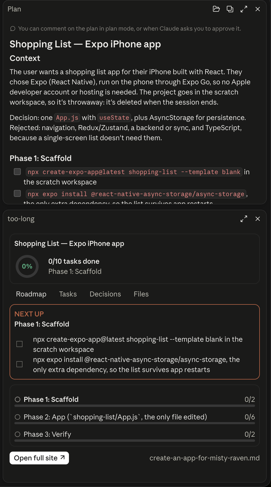

# too-long

### Claude wrote a 400-line plan. You have 30 seconds. **Too long, just show me.**


**too-long** turns the long Markdown plans Claude writes into something you can review, approve and follow: a small website, a live side pane in Claude Code, or a two-minute narrated video. Your plan file stays the single source of truth.

## Why use it

| Without too-long | With too-long |
|---|---|
| Scroll 400 lines to find what Claude intends to do | An overview, a TL;DR and every section at a glance |
| Approve a plan you only half read | See the roadmap, decisions and risks first |
| No idea what is done once Claude builds | Claude ticks each task as it finishes; you watch it live |
| Decisions and risks buried in prose | Each decision next to what was rejected, each risk next to its mitigation |

## Three ways to use it

| | What it is | Command |
|---|---|---|
| **Website** | The plan as a small site: overview, roadmap, tasks, decisions, diagrams, files | `/too-long plan.md` |
| **Live in Claude Code** | A side pane: review a plan before you approve it, then track it while Claude builds | `/too-long-live` |
| **Video** | A narrated ~2 minute explainer, rendered on your machine | `/too-long plan.md --video` |

## See it

**Website**


**Claude Code, terminal**


**Claude Code, desktop app**



## Why you can trust it

- **Nothing is left out or made up.** The full document is one click away; anything Claude adds is labelled.
- **One source of truth.** Ticks from Claude, the pane, the site or your editor are one `[ ]` to `[x]` in your Markdown.
- **It is yours.** No account, no server to host, no build step.

## Get it

Paste this into Claude Code:

```text
Install the too-long skill from https://github.com/GalHavshush/too-long: clone it into ~/.claude/skills/too-long (create ~/.claude/skills if it doesn't exist; if too-long is already there, run git pull in it instead). Then check that ~/.claude/skills/too-long/SKILL.md exists and tell me how to use it.
```

Then, in a new session: `Use too-long on plan.md`. Want it live inside Claude Code? Add the plugin:

```text
/plugin install too-long-live --marketplace GalHavshush/too-long
```

## More

[Full guide](docs/guide.md): installation, the live pane, video mode, configuration, supported Markdown, how it works, troubleshooting. [Architecture](docs/architecture.md) · [Model](docs/model.md) · [License](LICENSE)
