# too-long

**Too long. Just show me.**

Claude just wrote you a long implementation plan. Phases, checklists, decisions, risks, file paths, diagrams. You were never going to read all of it.

**too-long** is a [Claude Code](https://claude.com/claude-code) skill that turns that Markdown into a small website you will actually use. Say *"use too-long on plan.md"* and open the result.

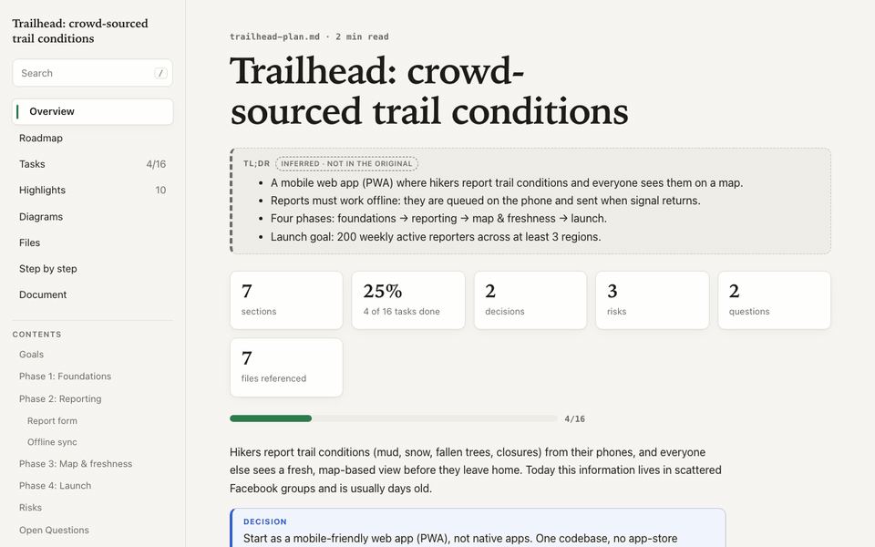

## Three ways to use it

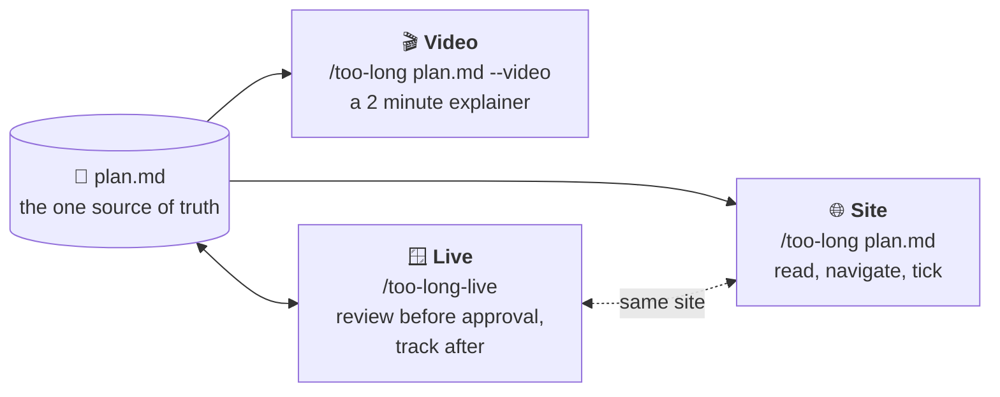

| | What it is | Install | Use |
|---|---|---|---|
| 🌐 **Site** | The plan as a small website: overview, roadmap, tasks, decisions, diagrams, files | the skill | `/too-long plan.md` |
| 🎬 **Video** | A narrated ~2 minute explainer, rendered on your machine | the skill (+ Chrome, ffmpeg, Node) | `/too-long plan.md --video` |
| 🪟 **Live** | A side pane in Claude Code: review the plan before you approve it, track it as Claude works | the skill **+** the `too-long-live` plugin | `/too-long-live` |

## What you get

- **The gist first.** An overview with a TL;DR, progress and every section at a glance.
- **What to do next.** A roadmap that knows which phases are done, in progress, ready to start or blocked, and which can run in parallel.
- **A real checklist.** Every `- [ ]` in one place. Tick them in the browser, or run `serve` and the ticks are written back into your Markdown.
- **The decisions, not the noise.** Each architectural decision with the alternatives it rejected and the tradeoff it accepted, and each risk next to its mitigation.
- **The architecture.** Diagrams from the plan, plus ones Claude draws from it, clearly labelled as Claude's.
- **Every file the plan touches,** in one tree, with what already exists and what is still to be created.
- **Learn it or present it.** Step through it one section at a time.
- **Or just watch it.** Add `--video` for a narrated two-minute explainer, rendered on your machine.

## Why you can trust it

- **Nothing is left out.** The full document is always one click away, and every task, decision and file links back to the exact line it came from.
- **Nothing is made up.** What comes from your plan and what Claude added are kept apart. Claude's additions are labelled, and flagged when the plan changes under them.
- **It stays in sync.** Edit the plan and rebuild, or leave `watch` running. Rebuilding never needs Claude.
- **It's yours.** No account, no server, no npm, no build step. The site is a folder of static files; the only thing it ever downloads is the diagram library, and without it you see the diagram source.

## Get it

Paste this into Claude Code:

```text
Install the too-long skill from https://github.com/GalHavshush/too-long: clone it into ~/.claude/skills/too-long (create ~/.claude/skills if it doesn't exist; if too-long is already there, run git pull in it instead). Then check that ~/.claude/skills/too-long/SKILL.md exists and tell me how to use it.
```

Then, in a new session:

```text
Use too-long on plan.md
```

Claude asks what you want from it (read it, track it, see the architecture, learn it, present it), picks the views that fit, builds the site and opens it.

---

# Technical details

## Installation

You need [Claude Code](https://claude.com/claude-code) and Python 3.9+ (standard library only; tested on 3.9, 3.11 and 3.14).

The one-prompt install is [above](#get-it). To do it by hand:

For every project (personal skill):

```bash
git clone https://github.com/GalHavshush/too-long ~/.claude/skills/too-long
```

For one project only (commit it so your team gets it too):

```bash
git clone https://github.com/GalHavshush/too-long .claude/skills/too-long
```

Video mode (`--video`) needs a few extra local tools; see [Video mode](#video-mode). Everything else works with Python alone.

Start a new Claude Code session afterwards so the skill is picked up. To update:

```bash
git -C ~/.claude/skills/too-long pull
```

## Usage

Ask Claude Code in plain words and name the file:

```text
Use too-long on plan.md
too-long this plan
Make docs/spec.md easier to understand with too-long
Use too-long to turn this into a visual roadmap
```

Add `--video` for a narrated explainer video instead of a website (`Use too-long on plan.md --video`).

Claude reads the whole document, then asks what you want the visual version to help you do (unless you already said), for example:

- make it easier to read and navigate
- show it as a roadmap or timeline
- visualize architecture and relationships
- turn it into an implementation dashboard and track progress
- learn it step by step
- present it

You can pick several. Claude proposes which views fit *this* document, builds the site into `.too-long/`, and opens it.

You can also run it yourself with one command, `scripts/too_long.py`:

```bash
python3 ~/.claude/skills/too-long/scripts/too_long.py build plan.md    # build .too-long/
python3 ~/.claude/skills/too-long/scripts/too_long.py watch plan.md    # rebuild on every save
python3 ~/.claude/skills/too-long/scripts/too_long.py serve plan.md    # ticking a task writes [x] into plan.md
python3 ~/.claude/skills/too-long/scripts/too_long.py parse plan.md    # structure summary
python3 ~/.claude/skills/too-long/scripts/too_long.py doctor           # what is installed, what needs it
```

Output goes to `.too-long/` in the current folder (`--out DIR` to change it). The individual scripts (`build.py`, `watch.py`, `serve.py`, `parse.py`, `video.py`) take the same arguments.

## Why not just ask Claude for an HTML dashboard?

You can, and you get a one-off page that drifts from the plan the moment the plan changes. too-long is different:

- **Rebuilt from the Markdown, without an LLM.** Edit the plan and run `build` (or leave `watch` running). Claude is only involved in choosing views and writing the clearly labelled extras.
- **Nothing is dropped.** The Document view always renders every block, and the tests check that every word of each fixture survives parsing.
- **Inferred content is labelled and tracked.** A TL;DR, notes and diagrams Claude adds carry an "Inferred" badge, and are marked "May be outdated" when the sections they were based on change.
- **Traceable.** Every task, highlight, diagram and file mention links to its line in the Markdown.
- **Task state that can live in the Markdown.** Served locally, ticking a task writes `[x]` into the file (atomically, refusing if the file changed underneath).
- **Safe rendering.** Links are checked against an allowlist of schemes, raw HTML is shown as text, and the only third-party script (Mermaid) is pinned with an integrity hash.

## Example

[`examples/trailhead-plan.md`](examples/trailhead-plan.md) is a made-up plan for a trail-conditions app (95 lines): four phases with checkboxes, decisions, risks, open questions, a table, a Mermaid diagram and file paths. It is ordinary Markdown:

```markdown
## Phase 1: Foundations

Set up the project and the trail catalogue that everything else hangs off.

- [x] Create the SvelteKit app in `web/` with TypeScript and Vitest
- [x] Add Postgres + PostGIS via `docker-compose.yml`
- [x] Import trail geometries from OpenStreetMap into `trails` with `scripts/import_osm.py`
- [ ] Trail search endpoint `GET /api/trails?q=` in `web/src/routes/api/trails/+server.ts`
```

The prompt was:

```text
Use too-long on examples/trailhead-plan.md. I want to track implementation, see the architecture, and be able to walk a new teammate through it.
```

The generated site is committed in [`examples/trailhead-site/`](examples/trailhead-site/). Clone the repo and open `examples/trailhead-site/index.html` to click around. Its [`config.json`](examples/trailhead-site/config.json) shows what Claude chose.

**Roadmap:** phases detected from the headings, with progress and a "current focus" card listing the next open tasks.

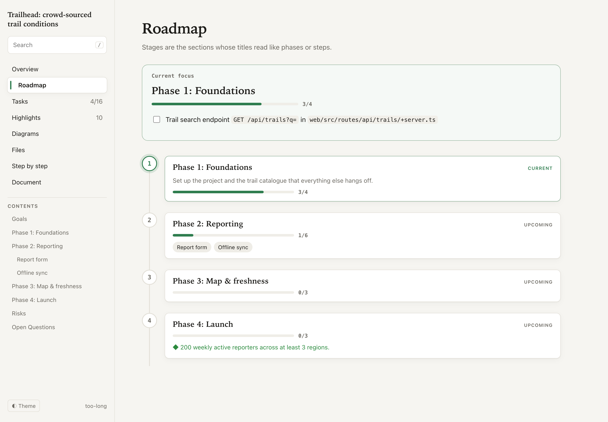

**Tasks:** every checkbox, grouped by section, with filters and a link to each task's source line. Opened as a file, checks are saved in your browser; served with `too_long.py serve`, they are written to the Markdown.

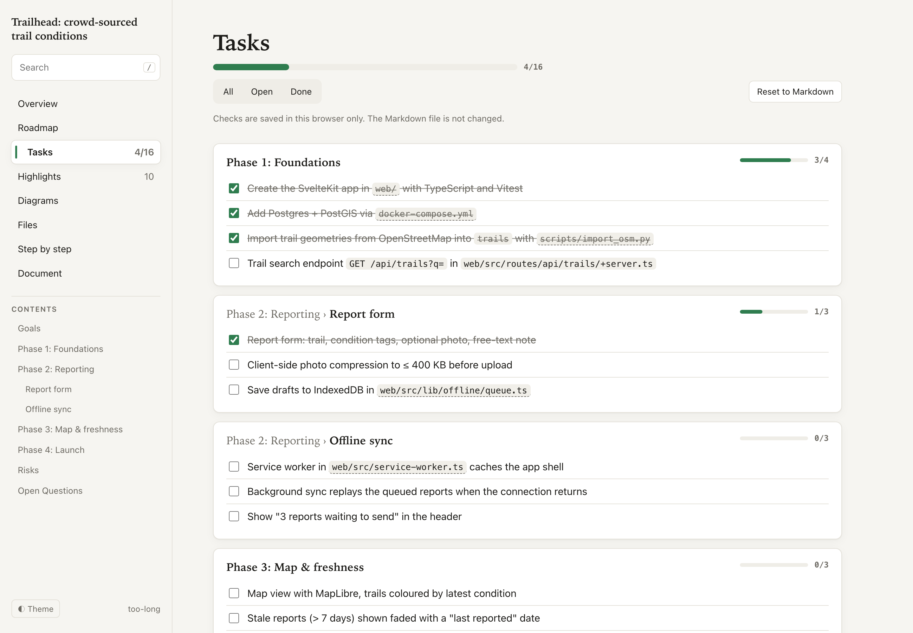

**Highlights:** decisions with their rejected alternatives and tradeoffs, risks with their mitigation, open questions, assumptions and milestones, each linking back to where it appears.

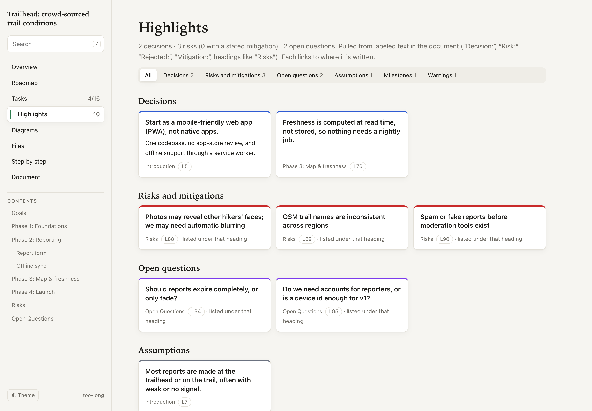

**Diagrams:** Mermaid diagrams from the document, plus diagrams Claude drew from the text, clearly labelled as inferred.

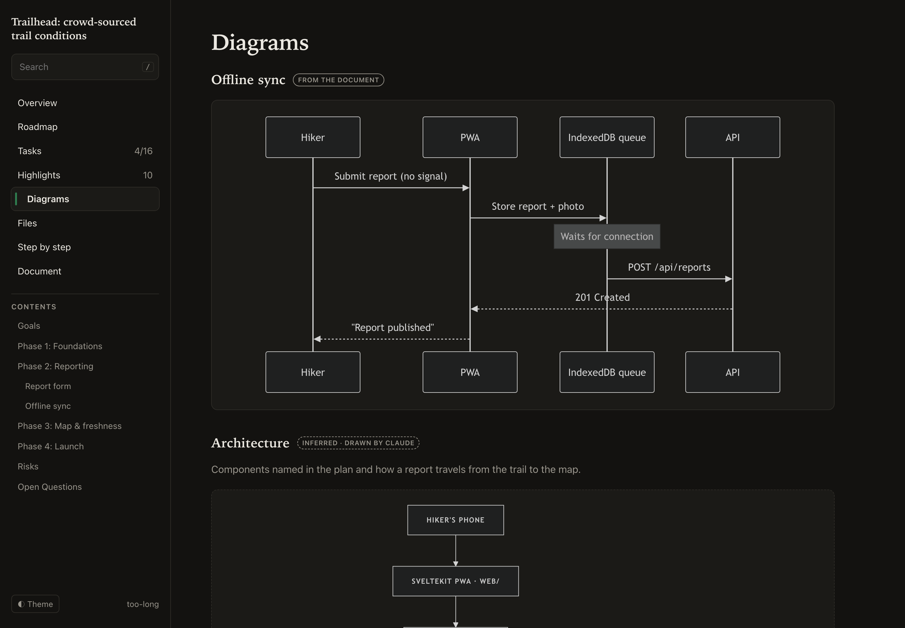

**Step by step:** one section per screen, arrow-key navigation, and "mark as understood".

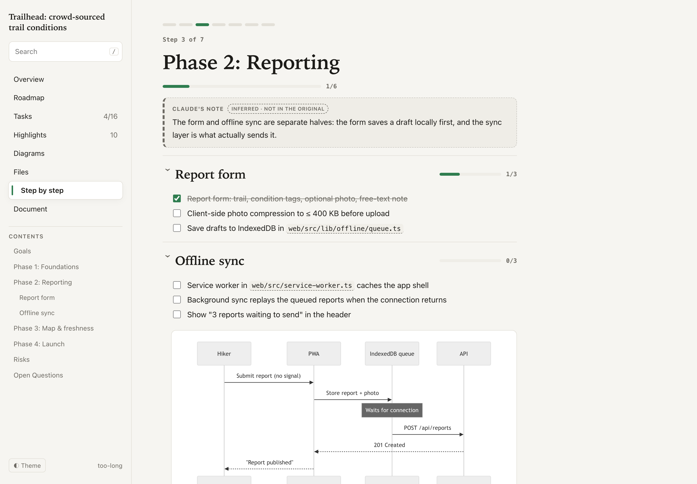

**Document:** the full document with collapsible sections, a scroll-synced table of contents, search, and a raw Markdown toggle.

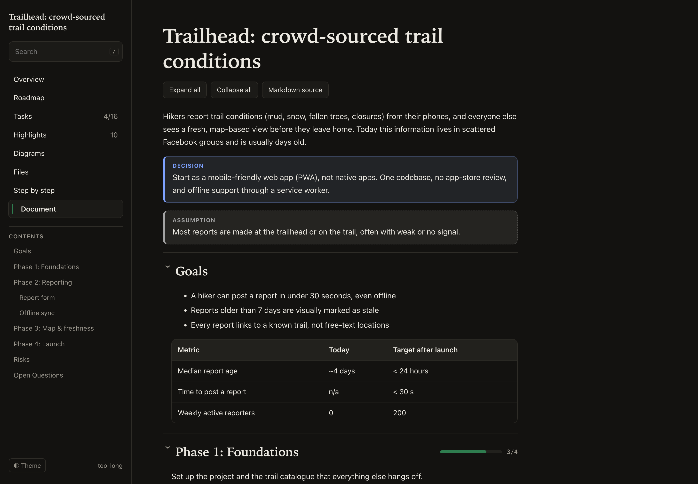

## too-long-live: review and track plans in Claude Code

**too-long-live** is an optional add-on to the skill. It puts the plan in a pane beside the transcript, and teaches Claude to write plans you can review and to tick them off as it works.

### See it

**1. Before approval:** for a long plan, Claude asks whether you want a visual review, and what for.

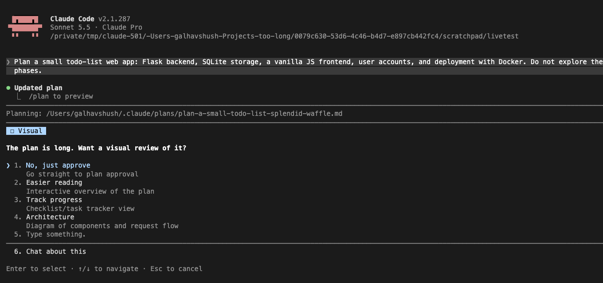

**2. While Claude builds:** the pane sits beside the transcript. Here Claude has implemented the app and ticked 20 of 25 tasks by itself; the roadmap shows the finished phases and what is next.

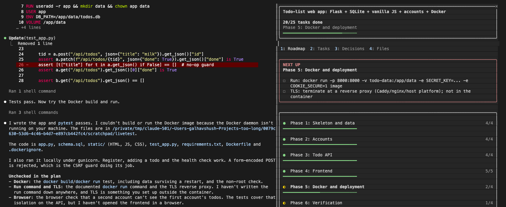

**3. The decisions and risks:** every labelled decision, and every risk next to its mitigation, without reading the plan again.

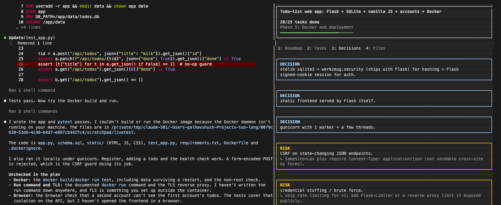

### The loop

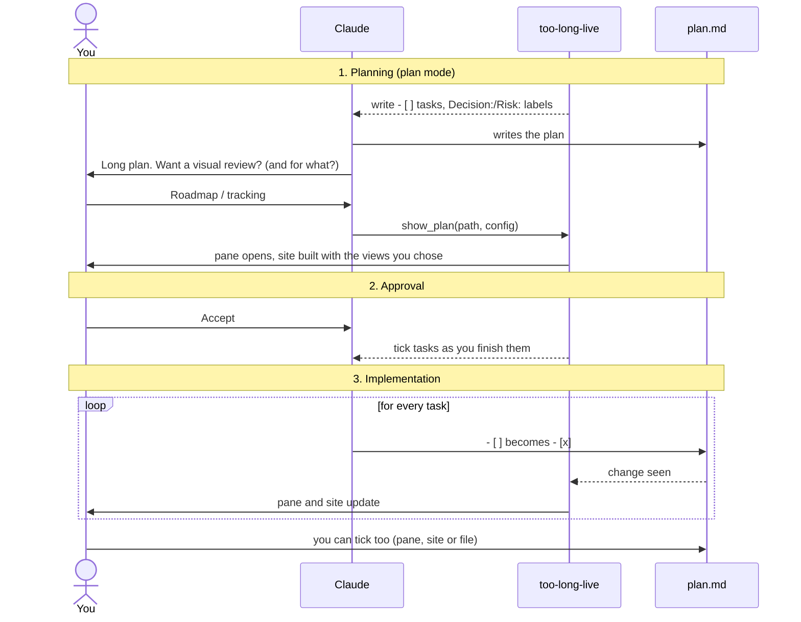

| Moment | What happens | You do |
|---|---|---|
| 📝 **Claude plans** | The plan is written as `- [ ]` tasks with labelled decisions and risks. For a **long plan** (about 60+ lines or 4+ sections) Claude asks whether you want a visual review, and what for | Pick a goal, or skip |
| 🔎 **Review** | The pane and site open with views chosen for your goal (roadmap, TL;DR, diagrams, dependencies) | Read, ask for changes |
| ✅ **Approval** | The normal Accept / Reject / Revise card, unchanged | Accept |
| 🔨 **Claude builds** | Claude ticks each task in the plan as it finishes it | Watch the pane |
| 🔁 **Any time** | `/too-long-live` reopens the project's last plan with every tick in place, even in a new conversation | Run it |

Nothing opens on its own, and the pane itself calls no model.

### One source of truth

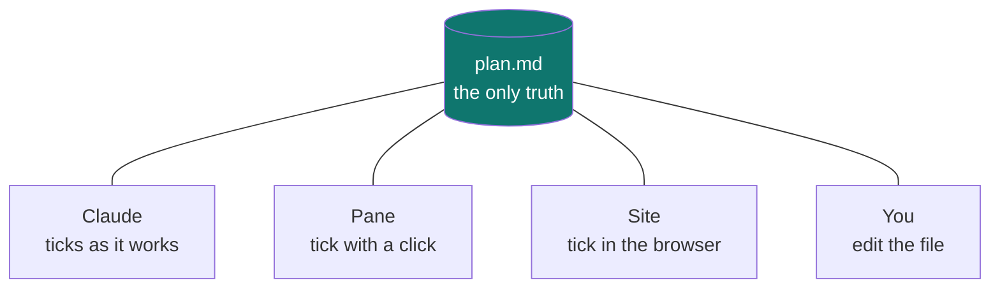

Every tick, from anywhere, is one `[ ]` → `[x]` character written into the Markdown. A write based on an old version of the file is refused, so nobody's edit is silently overwritten.

### The pane

- the plan's progress and roadmap stages, with the next open tasks;
- every task, which you can tick;
- decisions, risks with their mitigations, and open questions;
- the files the plan mentions, marked as already in the project or still to create;
- an **Open full site** button: the same site, served live on 127.0.0.1.

### Install

The pane runs the skill's own scripts from `~/.claude/skills/too-long`, so install the skill first (see [Installation](#installation)), then the add-on, from a terminal session (it then loads in the desktop app's Code tab too; Claude Code 2.1.275 or later):

```text
/plugin install too-long-live --marketplace GalHavshush/too-long
```

Answer `y` to add the marketplace and pick the user scope. Without the skill the pane tells you how to install it.

### Where things are

| Surface | Offer to open the pane |
|---|---|
| Terminal | Claude's review question, `/too-long-live`, and a **[Open plan in too-long]** button above the prompt (hidden while the approval screen is up) |
| Desktop app | Claude's review question and `/too-long-live` (the app does not draw mod buttons near plan approval) |

The site the pane builds goes next to the plan, in `<plan's folder>/.too-long/<plan name>/`, e.g. `~/.claude/plans/.too-long/<name>/`. It is the same site the skill builds and enriches.

The add-on is a Claude Code mod in [`live/`](live/hooks/register.tsx), over the skill's Python core through `scripts/pane.py`. It needs Python 3.9+ on `PATH`. To work on it:
- load it with `claude --plugin-dir live`;
- validate it with `claude plugin validate live`;
- run its tests with `claude plugin test live`.

## Video mode

Add `--video` to get a ~2 minute narrated explainer video instead of a website:

```text
/too-long plan.md --video
```

Claude finds the story in your plan, writes a short script and a storyboard (title, goals, decisions, a diagram, the phases, risks, what success looks like), then renders it locally to `.too-long/video/<name>-explainer.mp4`. 
**Watch the example:** [`examples/trailhead-video/trailhead-plan-explainer.mp4`](examples/trailhead-video/trailhead-plan-explainer.mp4) (1:51, narrated) is made from the same Trailhead plan. Its [`storyboard.json`](examples/trailhead-video/storyboard.json) and [`narration.txt`](examples/trailhead-video/narration.txt) sit next to it.

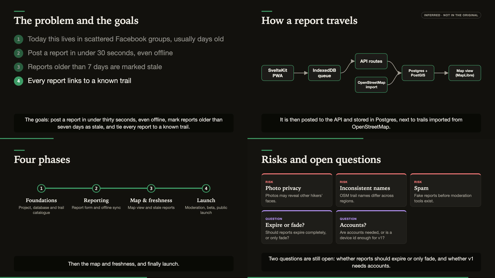

Everything stays on your machine: the voice is macOS `say`, frames are drawn by headless Chrome, and ffmpeg encodes the result. No cloud services. Without `say` (Linux, Windows) you still get a captioned video. What you need, on macOS:

```bash
brew install ffmpeg      # encodes the video
brew install node        # Node 22+ (drives Chrome; no npm packages)
```

plus Google Chrome (or Chromium/Edge/Brave). `python3 ~/.claude/skills/too-long/scripts/too_long.py doctor` checks all of it and prints the install command for your OS. Video rendering has been tested on macOS only. Rendering takes a few minutes. The same source-fidelity rules apply: code snippets and file paths must exist in your Markdown, and anything Claude had to infer gets an "Inferred" badge on screen.

## Views

Only the views that fit the document and your goal are generated.

| View | What it shows |
|---|---|
| Overview | Title, TL;DR, stats, intro, section cards with progress |
| Document | The whole document. Always included |
| Roadmap | Stages with progress; when the plan states dependencies, what each stage needs, ready/blocked status and parallel waves |
| Tasks | All checkboxes (or numbered steps you choose to track), with progress |
| Highlights | Decisions with their rejected alternatives, risks with likelihood/impact and mitigation, open questions, assumptions, milestones |
| Diagrams | Mermaid from the document + inferred diagrams |
| Files | Tree of every file path the document mentions, merged when written two ways, marked on disk / not on disk / ambiguous |
| Step by step | One section at a time, for learning or presenting |

Every site has search, light/dark mode, works on phones, and has a Source view (`#/source/<line>`) showing the Markdown exactly as written; the "L42" links on tasks, highlights, diagrams and files open it at that line.

## Keeping the site in sync

| How you open it | Task checks | When the Markdown changes |
|---|---|---|
| `index.html` from disk (file://) | Saved in this browser only. The Markdown is not changed. | Run `build` again, then reload |
| `too_long.py watch plan.md` + `index.html` | Same as above | Rebuilt on every save; reload the page |
| `too_long.py serve plan.md`, open `http://127.0.0.1:8765/` | Written to the Markdown (`- [ ]` ↔ `- [x]`) | The open page reloads itself |
| The side pane in Claude Code | Written to the Markdown | The pane follows within ~2 s; its **Open full site** serves the site the same way |

The skill serves the site when it builds it, so the Markdown, the site and the side pane are three views of one plan: a tick in any of them shows in the others. The pane uses the same site folder as the skill (it finds it through `build.json`), with the views and extras Claude chose.

Details of served mode:

- Only the checkbox character changes; line endings, spacing and everything else stay byte-for-byte.
- If the file changed since the page loaded, the write is refused and the page reloads.
- Writers are serialised with an OS lock on a `.plan.md.too-long.lock` file next to the Markdown.
- The server listens on 127.0.0.1 only, needs a per-run token, and refuses cross-site requests.
- Numbered steps you chose to track (config `track`) have no checkbox in the Markdown, so their checks always stay in the browser.

Browser state is keyed by a document id kept in `.too-long/build.json`, so two plans with the same title never share checks, and checks follow tasks through edits. Delete that file to start fresh.

## Configuration

Claude writes `.too-long/config.json`; you can edit it too. Every field is optional.

| Field | Meaning |
|---|---|
| `views` | Which views, in order; the first is the landing page. `document` is always added. |
| `accent` | A CSS color (`"#0f766e"`, `"teal"`, `"oklch(60% 0.1 190)"`). |
| `tldr` | Bullets for the overview. Inferred. |
| `notes` | `{section-id: text}` shown at the top of a section. Inferred. |
| `diagrams` | `[{title, description, mermaid, sources: [section-id]}]`. Inferred. |
| `roadmap` | Section ids to use as roadmap stages, when heading detection picks the wrong ones. |
| `track` | Section ids whose numbered `1. 2. 3.` steps become tasks. |
| `dependencies` | `{stage-id: [stage-ids]}`: what a roadmap stage needs, when the document doesn't say it on a `Dependencies:` line. Replaces what was found for that stage; shown as inferred. |

Section ids come from `too_long.py parse plan.md`. A config that cites an unknown id is refused when it is new. If the config was valid and a heading was renamed later, the build continues and warns instead. The page template lives in `assets/` (`index.html`, `styles.css`, `app.js`, plain HTML/CSS/JS); change it there to customise every site.

## Supported Markdown

too-long uses its own small parser (Python standard library only), so the supported syntax is a documented subset:

- Headings: `#`…`######`, and `===`/`---` setext. A single `#` is the title; the next level down are the sections, and the level below that the subsections.
- Lists: `-` `*` `+` and `1.` `1)`, nested by indentation (tabs count as 4 spaces). Task lists `- [ ]` / `- [x]` at any depth, and inside blockquotes.
- Code: fenced (backticks or tildes, inside lists too) and 4-space indented. ```` ```mermaid ```` blocks become diagrams.
- Tables: pipe tables, with `\|` and `` `a|b` `` inside cells.
- Links: inline `[text](url)`, reference `[text][ref]` / `[ref]`, `<https://…>` and bare URLs, plus images.
- Other blocks: blockquotes, GitHub alerts (`> [!WARNING]`), horizontal rules, YAML front matter.
- Highlights: see [What it extracts](#what-it-extracts) below.
- Not supported: raw HTML (shown as text), footnotes, definition lists. An unclosed code fence runs to the end of the file (as in CommonMark) and is reported as a warning.

## What it extracts

Everything below is deterministic: plain rules over the text, no LLM, re-run on every build. The rules are conservative: when the text doesn't say something explicitly, too-long leaves it out rather than guess. It stays visible in the Document view either way.

**Decisions.** Any of these is one decision:

```markdown
Decision: Use PostgreSQL.
**Decision:** Keep the API stateless.
**Decision 3 — Short leases with heartbeat renewal.**
### Decision 2: Fenced claims
## Decision            (ADR style: the section is the decision)
```

The labeled statement is the decision. Labels that follow it belong to it: `Rejected:` (inline, or the list after it) becomes the rejected alternatives, and `Tradeoff:`, `Rationale:`/`Why:`, `Consequences:`, `Context:`, `Status:` become details. A numbered decision inside a "Decisions" section, or a decision heading, also keeps the unlabeled paragraphs after it. Bullets under a "Decisions" heading count as decisions only when the section has no explicitly labeled ones, so a list of rejected alternatives never becomes a list of decisions.

**Risks, questions, assumptions, milestones, warnings** use the same labels (`Risk:`, `Open question:`, `Assumption:`, `Milestone:`, `> [!WARNING]`). A `Mitigation:`, `Contingency:`, `Likelihood:`, `Impact:`, `Owner:` or `Answer:` belongs to the highlight right before it: in the same sentence run, the next paragraph, the next bullet, or a child bullet. It is never a highlight of its own. A table whose first column is "Risk" (or one under a "Risks" heading) gives one risk per row, with the other columns as details; `Likelihood / Impact` cells like `M / H` split in two. A bold label later in a sentence (`... **Milestone:** M1 alpha.`) is found too. Bullets under a heading that names two kinds ("Risks and decisions") are left unclassified unless labeled.

**Stage dependencies.** A stage's `Dependencies:` / `Depends on:` / `Requires:` / `Prerequisites:` / `Blocked by:` line is read as follows:

- The first sentence lists what the stage needs: `P2, P3`, `Phase 1`, `P1–P3`, an exact stage title, `All prior phases`, or `None`.
- A later sentence with "needs", "requires" or "after" adds a *partial* dependency (shown, but never blocking).
- "Can run in parallel with P7" records parallel stages, never dependencies.
- A line that names no stage leaves the dependencies unknown, with a warning.
- References to missing stages and dependency cycles are reported.

When the text implies dependencies without labeling them, Claude can state them in config `dependencies`; they are then marked inferred.

**Roadmap status:**

| Status | When |
|---|---|
| done | every task in the stage is checked |
| in progress | some tasks are checked |
| ready | nothing checked yet, and every stage it needs (stated or from config) is done |
| blocked | nothing checked yet, and a stage it needs is not done |
| not started | nothing checked yet, and its dependencies are unknown, part of a cycle, or depend on a stage without tasks; no ready/blocked claim is made |

Partial dependencies never block. If every stage's dependencies are known, stages are grouped into waves that can run in parallel. A plan that states no dependencies keeps the simple order: the first unfinished stage is the current one.

**File references.**

- `src/x/{a,b}.py` expands to two files.
- A short reference (`config.py`, `db/models.py`) is merged with the one longer path in the document it ends with. If it could be several files, it stays separate and lists the candidates. `../` and absolute paths are never merged.
- Each path is then looked up from the git repository root, or, outside a repository, from the Markdown's folder, and marked **on disk**, **not on disk** (a file the plan will create, or a misspelled path; never assumed to exist), or **ambiguous**.
- In a git repository, a short reference that matches exactly one file there links to it.

**Deterministic vs inferred.** Everything above comes from the document and links to its source line. Only what Claude writes in `config.json` (TL;DR, notes, diagrams, `dependencies`) is inferred, and the site labels it that way. The JSON model is documented in [`docs/model.md`](docs/model.md).

## Faithful to the source

The Markdown is the source of truth. too-long never removes content (the Document view always shows everything) and never invents requirements, tasks, decisions or dependencies. Anything Claude adds, like a TL;DR, a section note or an architecture diagram, is labelled **"Inferred · not in the original"**. When the part of the document it was based on changes, it is also marked **"May be outdated"**. It is never rewritten automatically; ask Claude to update the config.

## How it works

```
plan.md ──parse.py──▶ content model ──(Claude: pick views, write config.json)──▶ build.py ──▶ .too-long/
                                                                                              index.html
                                                                                              styles.css
                                                                                              app.js
                                                                                              data.js
```

1. **`scripts/parse.py`** turns Markdown into a JSON content model: sections, blocks with source line numbers, and indexes of tasks, callouts, diagrams and file paths.
2. **Claude** picks the views for your goal and writes `config.json`.
3. **`scripts/build.py`** validates the config, keeps ids stable across builds (`build.json`), flags stale inferred content, and writes the site. `assets/app.js` (vanilla JS) renders the views from `data.js`.

The core modules have no HTTP, browser or printing in them, so the CLI, the watcher, the local server, and later an editor integration all share them. [`docs/architecture.md`](docs/architecture.md) explains the pieces, and [`docs/model.md`](docs/model.md) documents the JSON model and its invariants. [`SKILL.md`](SKILL.md) holds the instructions Claude follows.

```
too-long/
├── SKILL.md            # what Claude follows
├── scripts/
│   ├── parse.py        # Markdown → content model
│   ├── build.py        # content model + config → site
│   ├── watch.py        # rebuild on every save
│   ├── serve.py        # local server: task checks written to the Markdown (sync.py)
│   ├── config.py identity.py model.py regen.py website.py sync.py  # the reusable core (docs/model.md)
│   ├── args.py         # parses "<file.md> [--video]"
│   ├── video.py        # storyboard → narration → timing → mp4 (video mode)
│   ├── render_video.mjs# frame capture via headless Chrome
│   ├── cdp.mjs         # tiny Chrome DevTools client (video frames, browser tests)
│   ├── too_long.py     # the command line: build, watch, serve, parse, video, doctor
│   └── run_tests.py    # runs everything in tests/: python3 scripts/run_tests.py
├── video.md            # what Claude follows in video mode (storyboard schema)
├── tests/              # parser fixtures + golden files, unit tests, browser tests (e2e.test.mjs)
├── assets/             # site template (HTML, CSS, vanilla JS) + assets/video/ frame player
├── examples/           # example plan + generated site
└── docs/                 # architecture.md, model.md, screenshots/
```

## Testing

```bash
python3 scripts/run_tests.py
```

This runs everything:

- golden-file parser tests over readable fixtures in `tests/fixtures/`
- semantic snapshots of realistic plans (`tests/test_semantic.py`, `tests/golden/semantic/`): which decisions, rejected alternatives, mitigations, stage dependencies and merged file references are extracted. Excerpts of TaskForge, a 7,800-word implementation plan used for testing, are among the fixtures
- unit tests for identity, config, regeneration, sync, the server, the CLI and the side pane's `pane.py`
- browser tests (`tests/e2e.test.mjs`) that build sites and drive headless Chrome over the DevTools protocol, with no npm packages

The side pane's own tests run in Claude Code's mod test kit: `claude plugin test live`. The browser tests need Node 22+ and Chrome and skip themselves without them. After an intended parser change, regenerate the golden files with `python3 tests/test_golden.py --update` and `python3 tests/test_semantic.py --update`, and review the diff.

## Troubleshooting

| Problem | Fix |
|---|---|
| `... is not UTF-8 text` | Re-save the file as UTF-8 (the message includes an `iconv` command). |
| `config 'notes' has unknown section id` | Use an id from `too_long.py parse plan.md`; headings changed since the config was written. |
| `config.json:3:14: invalid JSON` | Fix the JSON at that line and column (often a trailing comma). |
| Diagrams show their source instead of a picture | Mermaid loads from cdn.jsdelivr.net the first time; you're offline, it's blocked, or the diagram has a syntax error. |
| Ticking a task doesn't change the Markdown | That only happens with `too_long.py serve`; a page opened from disk saves checks in the browser. |
| "The Markdown changed since this page loaded" | Someone (or Claude) edited the file; the page reloads, then tick again. |
| `Could not listen on 127.0.0.1:8765` | Something else uses the port: `serve plan.md --port 8766`. |
| A decision or risk is missing from Highlights | It needs an explicit label (`Decision:`, `**Decision 3 —**`, `Risk:`...) or a "Decisions"/"Risks" heading; unlabeled prose is left in the Document view on purpose. |
| A stage shows "not started" instead of ready/blocked | Its dependencies aren't stated (or the line names no stage). Add a `Dependencies:` line, or have Claude set config `dependencies`. |
| A file shows "not on disk" | It isn't at that path from the repository root (or the Markdown's folder). Planned files are expected to show this. |
| Checks disappeared after a rebuild | The task's text changed, or `.too-long/build.json` was deleted; too-long won't carry a check over to a task it can't match with confidence. |
| Video tools missing | `too_long.py doctor` lists what's missing and the install command for your OS. |

## Limits

- Mermaid diagrams load mermaid.js (pinned, integrity-checked) from a CDN the first time. Offline, the diagram source is shown instead.
- Opened as a file, task checks are stored in the browser only; writing them to the Markdown needs `serve`.
- Raw HTML inside the Markdown is shown as text.
- The parser covers the subset above, not all of CommonMark.
- Highlights and dependencies are found from explicit labels only. A decision written as plain prose, or a dependency implied but not labeled, is not extracted (Claude can add dependencies through the config).

## License

[MIT](LICENSE)
