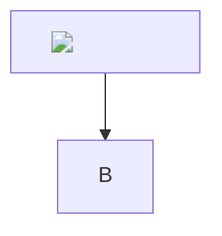

#  Hostile plan

Intro with <script>window.__pwned=1</script> and <b onmouseover="window.__pwned=1">raw html</b>.

## Links <svg onload="window.__pwned=1">

- [js](javascript:window.__pwned=1)
- [mixed case](JaVaScRiPt:window.__pwned=1)
- [control char](javascript:window.__pwned=1)
- [vbscript](vbscript:msgbox)
- [data](data:text/html,<script>window.__pwned=1</script>)
- [entity](javascript&#58;window.__pwned=1)
- [quote](https://example.com/"onmouseover="window.__pwned=1)
- [emphasis in url](https://example.com/*a*/_b_/~~c~~)
- **[bold link](https://example.com/__x__)**
- [ok link](https://example.com/ok) and [relative](docs/guide.md) and [anchor](#links)
- [ref link][evil] and [good ref][good]
- autolink https://example.com/"onmouseover="window.__pwned=1
- [ ] task with 


| a  | `b"onclick="window.__pwned=1.py` |
|---|---|
| <iframe src="javascript:window.__pwned=1"></iframe> | x |

Decision: use `a"onmouseover="x.ts` and `src/ok.ts`.

```html
<script>window.__pwned=1</script>
```



[evil]: javascript:window.__pwned=1
[good]: https://example.com/good
